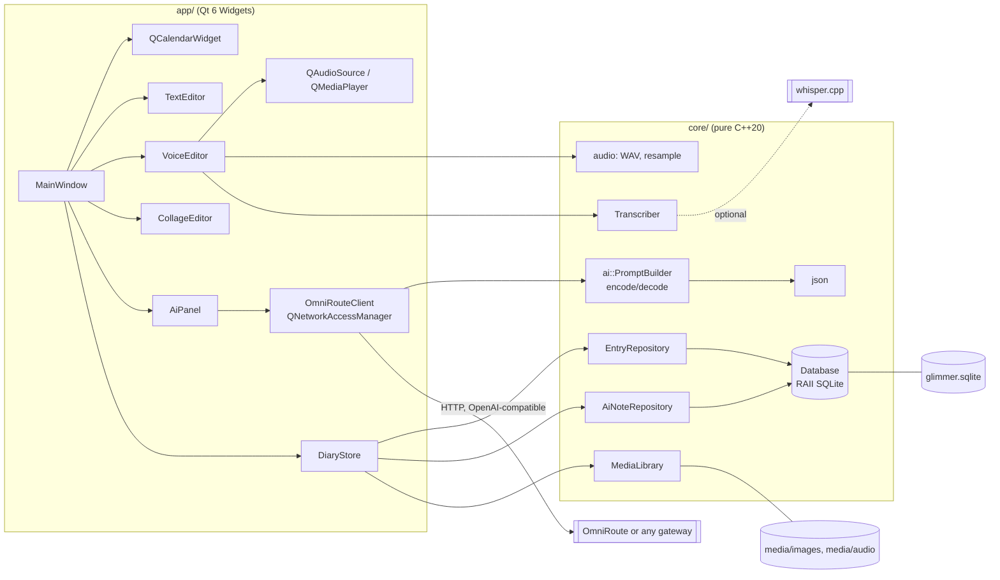

# Architecture

glimmer is two layers: a **core library** with all the logic and no GUI,
and a thin **Qt app** on top of it.



## Rules that keep it maintainable

| Rule | Why |
|---|---|
| `core/` never includes Qt | It can be unit-tested quickly, under sanitizers, on any CI runner. |
| Only repositories contain SQL | The schema can change without touching the UI. |
| Qt ↔ core conversions only in `qt_convert.hpp` | One place for UTF-8 and date handling. |
| AI output goes to `ai_notes`, never into `entries` | The diary always shows exactly what you wrote. |
| The network call lives in `app/`; prompt building and parsing live in `core/` | The interesting AI logic is testable without a network. |
| Media paths are stored relative and go through `MediaLibrary::resolve()` | The data folder is portable, and stored paths can't escape it (path-traversal safe). |

## Data model

```
entries        id, entry_date (YYYY-MM-DD), kind (text|voice|collage),
               title, body, audio_path, created_at, updated_at
collage_items  id, entry_id → entries.id (ON DELETE CASCADE),
               image_path, x, y, scale, rotation, z
ai_notes       id, kind (summary|prompt|answer), range_start, range_end,
               request, content, model, created_at
```

The schema version lives in `PRAGMA user_version`; `migrate()` runs each new
migration once, inside a transaction.

## Threads

Everything runs on the UI thread except **transcription**, which runs on Qt's
thread pool via `QtConcurrent::run`. The worker lambda captures only values
and a `shared_ptr<Transcriber>`, never a widget, so closing the editor in
the middle of a transcription is safe. HTTP is asynchronous through
`QNetworkAccessManager`, so it doesn't need a thread.

## Error handling

Core reports failures as exceptions (`DatabaseError`, `ai::AiError`,
`audio::AudioError`, `MediaError`, `TranscriptionError`). The app catches
them at the boundary where it can tell the user something useful: a
message box or the status bar. Destructors never throw.

See [adr/](adr/) for the reasoning behind the major choices.
